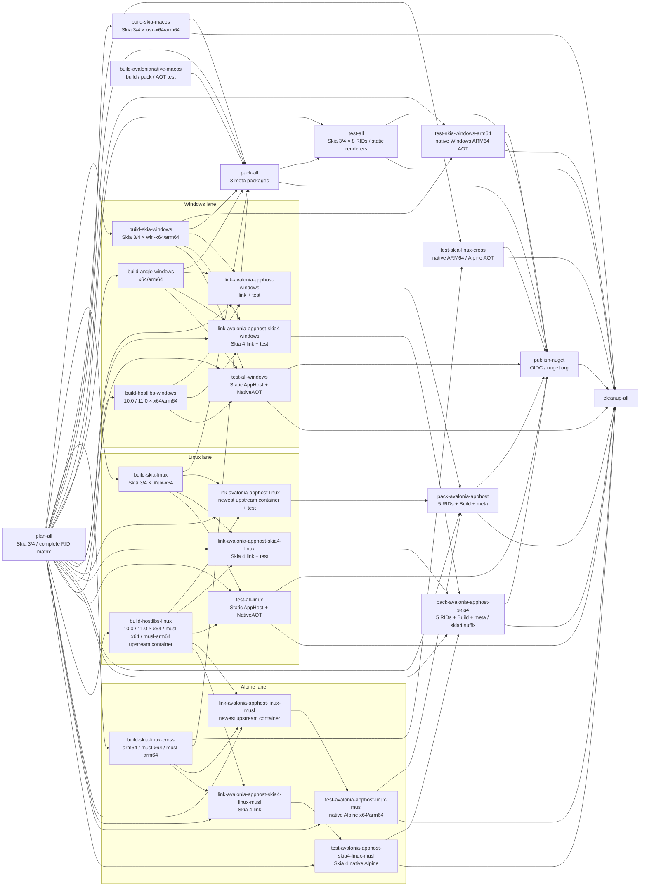

# HostForge 开发与构建指南

本文面向仓库维护者和希望从源码构建 HostForge 的开发者。包的消费方式请从根目录 [README](README.md) 进入对应包文档。

除非特别说明，以下命令都在仓库根目录执行。

## 版本来源

上游版本只写在以下规范文件中：

| 文件 | 内容 |
| --- | --- |
| [`Directory.Build.props`](Directory.Build.props) | `AvaloniaVersion` / `AvaloniaNativeVersion`（两者必须相等）、`AngleVersion`、默认 `SkiaSharpVersion`、各 SkiaSharp 版本对应的 `HarfBuzzVersion`、`HostForgeTargetFrameworks` 与各 TFM 的 `HostLibsNet*Version`；以及各包的版本公式 |
| [`native/hostlibs/versions.json`](native/hostlibs/versions.json) | 每个 .NET 运行时版本对应的 VMR 标签与 commit，以及该 commit 的 Linux 官方构建容器（`containers`，每个 Linux RID 一个，以 digest 固定） |
| [`native/skiasharp/versions.json`](native/skiasharp/versions.json) | 每个 SkiaSharp 版本对应的 mono/skia commit 与 HarfBuzzSharp 版本 |
| [`native/avalonianative/conandata.yml`](native/avalonianative/conandata.yml) | 每个 Avalonia 版本的源码归档 URL、SHA-256 与 commit |
| [`native/angle/conandata.yml`](native/angle/conandata.yml) | ANGLE 的分支（仅记录）、固定 commit，以及 depot_tools commit |
| [`native/angle/conanfile.py`](native/angle/conanfile.py) | recipe 的 `version`，必须等于 `AngleVersion` |

包版本另见 [Native NuGet 修复版本](#native-nuget-修复版本) 与 [`AppHostStatic.csproj`](src/package-apphost-static/AppHostStatic.csproj) 的 `<Version>`。工具链版本分别固定在 [`install-llvm`](.github/actions/install-llvm/action.yml)、[`install-task`](.github/actions/install-task/action.yml)、[`install-uv`](.github/actions/install-uv/action.yml)、[`pyproject.toml`](pyproject.toml)（conan、ninja）和 [`tests/Directory.Build.targets`](tests/Directory.Build.targets)（`TUnitVersion`，所有测试工程共用）。Linux 构建镜像安装的 Task 与 uv 取前两个固定版本，以 docker 构建参数传入（`python scripts/upstream.py build-args` 输出这些参数），所以工具更新不改变 Dockerfile，也不改变原生库缓存键。

其他位置不重复版本号，而是读取规范文件：

```bash
python scripts/repo_versions.py                 # 以 JSON 输出全部值
python scripts/repo_versions.py --get hostlibs  # 输出单个值
```

CI 用 `--github-output` 把全部值写入 step outputs。`tests/native/test_repo_versions.py` 检查规范文件之间是否一致；`tests/native/test_version_literals.py` 检查规范文件、锁文件、文档（`*.md`、`*.txt`）和 `tests/native` 以外的文件没有重复固定的版本号。

Taskfile 中，传给 Conan 的版本（`build-hostlibs` 的 `HOSTLIBS_VERSION`、`build-skiasharp` 的 `SKIASHARP_VERSION`、`build-avalonianative` 的 `AVALONIA_VERSION`）不传时由 `scripts/repo_versions.py` 读取；只透传给 MSBuild 的版本不传时不加 `-p:`，由 `Directory.Build.props` 提供默认值。HostLibs、SkiaSharp 和 AvaloniaNative 的 recipe 必须显式传 `--version`，不受支持的版本会报错并列出支持的版本。

## 环境要求

通用要求：

- .NET 11 SDK（构建、打包和测试；测试工程目标为 `net11.0`）
- .NET 10 运行时（运行 `net10.0` 消费者测试）；Windows Avalonia AppHost 测试另需 .NET 9 运行时，用于验证不受支持 TFM 的回退
- Python 3.11+
- [uv](https://docs.astral.sh/uv/)
- Task
- Git
- Ninja
- CMake
- LLVM / Clang

Windows 构建环境：

- Windows 11
- MSVC Build Tools 14.50（VS 2026）
- Windows SDK 10.0.26100
- [LLVM](https://github.com/llvm/llvm-project/releases)，版本与 CI 的 [`install-llvm`](.github/actions/install-llvm/action.yml) 一致，默认路径为 `C:\Program Files\LLVM`
- Git for Windows（ANGLE 构建需要；depot_tools 由 recipe 自行获取，无需安装）

Linux 构建使用 Clang，并通过 sysroot 对齐 .NET Host、SkiaSharp 和 HarfBuzzSharp 的目标 ABI。背景和工具链说明见 [Linux 构建方法](docs/roadmap/2026-03-13-linux-build-methodology.md)。Linux 的原生库构建、Avalonia 模板链接和 Static AppHost 矩阵在容器中进行，需要 Docker 或 Podman。

macOS 的 SkiaSharp 构建需要 Command Line Tools；AvaloniaNative 构建需要完整的 Xcode 26.0.1，以及满足 Avalonia 源码 `global.json` 的 .NET 10 SDK（10.0.201 及以上）。

## 上游源码

HostLibs 从 [VMR](https://github.com/dotnet/dotnet) 发布标签中的 `src/runtime` 构建。官方运行时由 VMR 构建，安全修复会先直接合入 VMR，之后才回流到 `dotnet/runtime`。SingleFileHost 静态链接 CoreCLR，原生部分必须与官方运行时包中的托管部分同源。

[`native/hostlibs/versions.json`](native/hostlibs/versions.json) 为每个运行时版本记录构建它的 1xx SDK 带标签与 commit；该 commit 也是 `Microsoft.NETCore.App.Ref` nuspec 记录的 commit，以及已安装运行时 `shared/Microsoft.NETCore.App/<version>/.version` 的第一行。`containers` 是该 commit 的 `src/runtime/eng/pipelines/common/templates/pipeline-with-resources.yml` 中 `linux_x64`、`linux_musl_x64` 与 `linux_musl_arm64` 的镜像，即官方 Linux 构建使用的 Azure Linux 交叉编译容器（上游 LLVM 与目标 rootfs：glibc 为 Ubuntu 18.04，musl 为 Alpine）；上游只写标签时，按记录时该标签的 digest 固定。运行时补丁升级用 `task upstream-apply`（见 [上游跟踪与版本守卫](#上游跟踪与版本守卫)），它同时记录新 commit 的容器。新增 TFM 时手动修改：

1. 在 `versions.json` 中加入该运行时的标签、commit 与 `containers`。
2. 在 `Directory.Build.props` 中把 TFM 加入 `HostForgeTargetFrameworks`，并加入对应的 `HostLibsNet<N>Version` 与 `HostLibsVersion` 条件。
3. 递增 `_Major`，然后运行 `task upstream-lock`。

recipe 只稀疏检出 VMR 的 `src/runtime`，并关闭构建期依赖的 NuGet 审计：上游固定版本的构建任务依赖在发布后可能出现新公告，但不会进入宿主二进制。

无需预先检出上游仓库。Conan 在首次构建 recipe revision 时浅检出固定 commit，并将配置无关的源码保存在 source cache；每个 binary configuration 使用独立 build folder。每个 binary 使用隔离的源码副本，避免架构或 PGO flavor 共用输出；GN 输出与源码保持固定的相对布局，使 Conan build folder 的 hash 变化不影响编译缓存。

## 构建入口

根目录 [`Taskfile.yml`](Taskfile.yml) 是常用任务入口：

| 命令 | 作用 |
| --- | --- |
| `build-hostlibs` | 构建 .NET AppHost / SingleFileHost 静态库；`HOSTLIBS_VERSION` 取 `native/hostlibs/versions.json` 中的运行时版本，默认为 `HostLibsTargetFramework` 对应的运行时；Linux 的 `RID` 为 `linux-x64`（默认）、`linux-musl-x64` 或 `linux-musl-arm64`；`JOBS` 控制 Ninja 并发 |
| `build-skiasharp` | 构建 SkiaSharp / HarfBuzzSharp 静态库；`SKIASHARP_VERSION` 取 `native/skiasharp/versions.json` 中的版本，默认为 `Directory.Build.props` 的 `SkiaSharpVersion`；`RID`、`SYSROOT`、`JOBS` 可选；macOS 支持 `RID=osx-x64\|osx-arm64`，使用 CLT + GN，最多 4 并发 |
| `pack-graphics-meta` | 打包 SkiaSharp / Angle / Avalonia.Native 元包（依赖该组件全部支持 RID） |
| `build-angle` | 构建 Windows x64 / arm64 ANGLE 静态库 |
| `build-avalonianative` | 用 Xcode 26.0.1 构建 macOS AvaloniaNative（`RID=osx-x64\|osx-arm64`；`AVALONIA_VERSION` 默认为 `AvaloniaNativeVersion`） |
| `pack-avalonianative` | 打包单个 AvaloniaNative RID；包版本由 `Directory.Build.props` 配置 |
| `pack-avalonianative-meta` | 打包精确依赖两个 macOS RID 包的 AvaloniaNative 元包 |
| `test-avalonianative` | 验证版本与 AOT/RID 门控；macOS 上发布并运行窗口和字体测试 |
| `matrix` | 运行 Static AppHost 与 NativeAOT 集成矩阵 |
| `matrix-nativeaot` | 打包本地静态图形库并验证 NativeAOT 发布与运行 |
| `link-avalonia` | 生成指定操作系统（`TARGET_OS=windows\|linux\|linux-musl`）的 Avalonia 宿主模板，`RID` 只链接其中一个 RID；每个模板 TFM（`net10.0` / `net11.0`）链接各自运行时版本的 HostLibs |
| `avalonia-test` | 运行 Avalonia AppHost 集成测试 |
| `pack-avalonia` | 打包全部 Avalonia AppHost（RID 包 + Build + 元包） |
| `pack-avalonia-rid` | 打包单个 RID 的 Avalonia AppHost 模板（RID=win-x64\|win-arm64\|linux-x64\|linux-musl-x64\|linux-musl-arm64） |
| `pack-avalonia-build` | 打包 Build 包（targets + ModuleInitializer） |
| `pack-avalonia-meta` | 打包元包（依赖所有子包） |
| `pack-static-apphost` | 打包通用 Static AppHost；`TFM` 取 `HostForgeTargetFrameworks` 中的一项，默认为 `HostLibsTargetFramework`；每个运行时一个包版本 |
| `pack-skia-static` | 按 `RID` 与 `SKIASHARP_VERSION` 打包 SkiaSharp 静态库输入 |
| `pack-angle-static` | 打包 Windows ANGLE 静态库输入（win-x64 或 win-arm64） |
| `upstream-check` | 只读检查上游新版本与安全修复 |
| `upstream-apply` | 按组更新上游版本及包输入锁（默认 `inputs` 组） |
| `upstream-lock` | 向 `package-inputs.lock.json` 追加当前包版本 |

运行 `task --list` 可查看任务；通过 `NAME=value` 传入目标平台、RID 或打包模式。构建任务接受 `ARCH=x64|arm64`，`build-hostlibs` 另接受 `PGO=True|False`（区分大小写），Linux 构建还需传入 `SYSROOT`。

## Windows 构建

### 1. 构建 HostLibs

Windows 支持以下组合，`native/hostlibs/versions.json` 中的每个运行时版本各构建一次：

- `default`：`win-x64`、`win-arm64`
- `no-pgo`：`win-x64`、`win-arm64`

```powershell
task build-hostlibs                              # 默认运行时，x64
task build-hostlibs ARCH=arm64
task build-hostlibs PGO=False                    # no-pgo flavor
task build-hostlibs HOSTLIBS_VERSION=<运行时版本>  # 其他运行时
```

`python scripts/repo_versions.py --get hostlibs-versions` 列出全部运行时版本。

`CONAN_HOME` 设为 `build/conan` 的绝对路径。构建前先 `export CONAN_HOME=$(pwd)/build/conan`（或 PowerShell: `$env:CONAN_HOME = "$PWD\build\conan"`）。

SingleFileHost 的部分 CoreCLR 目标 PDB 路径很深，`CONAN_HOME` 路径较长时会超过 MSVC 的 `MAX_PATH`，报 `fatal error C1041: 无法打开程序数据库`。此时让 `CONAN_HOME` 使用短路径，例如 `subst Q: "$PWD\build"` 后设 `$env:CONAN_HOME = 'Q:\conan'`，完成后用 `subst Q: /d` 取消映射。

### 2. 构建 SkiaSharp / HarfBuzzSharp

```powershell
task build-skiasharp
task build-skiasharp ARCH=arm64
```

Windows HarfBuzzSharp 项目由 [`scripts/libHarfBuzzSharp.vcxproj.in`](scripts/libHarfBuzzSharp.vcxproj.in) 原样导出后实例化，仓库中的上游模板不由 recipe 修改。

### 3. 构建 ANGLE

```powershell
task build-angle
task build-angle ARCH=arm64
```

recipe 检出 `native/angle/conandata.yml` 固定的 ANGLE commit 与 depot_tools commit，无需预先安装 depot_tools，但需要 Git for Windows。升级方法、recipe 的职责和包内容详见 [`native/angle/README.md`](native/angle/README.md)。

### 4. 生成并验证 Avalonia 宿主

```powershell
task link-avalonia TARGET_OS=windows
task avalonia-test
```

`avalonia-test` 会按需打包平台 RID 包和 Build 包，并验证模板激活、动态本机库抑制、Windows ANGLE P/Invoke 从宿主解析和可执行文件运行行为。

### 5. 打包

```powershell
task pack-avalonia
task pack-static-apphost
task pack-static-apphost TFM=net11.0
task pack-skia-static
task pack-skia-static RID=win-arm64
task pack-angle-static
task pack-angle-static RID=win-arm64
task matrix-nativeaot
```

`pack-*-static` 的 `RID` 默认为 `win-x64`。`pack-avalonia` 依次打包所有 RID 包、Build 包和元包。也可单独打包某个 RID：`task pack-avalonia-rid RID=win-x64`。详细约定见 [Avalonia 打包说明](src/package-avalonia-apphost/DEVELOPMENT.md)。

## Linux 构建

HostLibs / AppHost 模板支持 `linux-x64`、`linux-musl-x64`、`linux-musl-arm64`；NativeAOT 静态图形包支持 `linux-x64`、`linux-arm64`、`linux-musl-x64`、`linux-musl-arm64`。

### 1. 构建 HostLibs

每个 RID 在该运行时与 RID 的官方构建容器（`versions.json` 的 `containers`）中交叉编译，工具链、目标 rootfs 与 PGO 数据均与官方 .NET 构建相同。[`linux.Dockerfile`](native/hostlibs/linux.Dockerfile) 的 `build` 阶段只在容器上加入运行 Task 的工具：

```bash
docker build $(python scripts/upstream.py build-args) -f native/hostlibs/linux.Dockerfile --target build --build-arg IMAGE=<containers 中的镜像> -t hostforge-hostlibs .
docker run --rm -v "$PWD:/work" hostforge-hostlibs task build-hostlibs RID=linux-x64 HOSTLIBS_VERSION=<运行时版本> SYSROOT=/crossrootfs/x64
```

`RID` 为 `linux-x64`（默认）、`linux-musl-x64` 或 `linux-musl-arm64`，`SYSROOT` 为容器中该架构的 rootfs（`/crossrootfs/x64` 或 `/crossrootfs/arm64`），通过 `ROOTFS_DIR` 环境变量传给 Runtime 的 `build.sh --cross`。`native/hostlibs/profiles/linux-musl-*` 设置 `libc=musl`，recipe 向 `build.sh` 传入 `--os linux-musl`，由上游脚本选择 musl RID、CMake 定义与 PGO 数据。

.NET 11 的 PGO 构建以 LTO 编译 GC，所以 .NET 11 的 HostLibs 含有容器内 LLVM 生成的 bitcode，只有不低于该版本的 LLVM 才能链接。

### 2. 构建 SkiaSharp / HarfBuzzSharp

```bash
task build-skiasharp SYSROOT=build/rootfs/x64
task pack-skia-static RID=linux-x64
task matrix-nativeaot
```

使用 `native/skiasharp/profiles/linux-x64`，同样通过 `ROOTFS_DIR` 环境变量传入 sysroot；可继续用 `CC`、`CXX` 和 `AR` 覆盖 GN 工具链命令。

其它 Linux RID 使用对应的 amd64 cross 镜像；`SYSROOT` 的末级目录为 `x64` 或 `arm64`，所有 Skia 编译均在 amd64 宿主执行。例如：

```bash
docker build $(python scripts/upstream.py build-args) -f native/skiasharp/linux-musl-arm64.Dockerfile -t hostforge-skia .
docker run --rm -v "$PWD:/work" hostforge-skia task build-skiasharp RID=linux-musl-arm64 SKIASHARP_VERSION=<版本> SYSROOT=/crossrootfs/arm64 JOBS=4
task pack-skia-static RID=linux-musl-arm64 SKIASHARP_VERSION=<版本>
```

省略 `SKIASHARP_VERSION` 时使用 `Directory.Build.props` 的 `SkiaSharpVersion`；可选版本见 `native/skiasharp/versions.json`。

### 3. 生成并验证 Avalonia 宿主

Linux 模板在最新运行时的官方构建容器中链接（`linux.Dockerfile` 的 `link` 阶段，rootfs 中加入 fontconfig），该容器的 LLVM 能链接每个运行时的 HostLibs：

```bash
docker build $(python scripts/upstream.py build-args) -f native/hostlibs/linux.Dockerfile --target link --build-arg IMAGE=<最新运行时的 linux-x64 容器> --build-arg RID=linux-x64 -t hostforge-link .
docker run --rm -v "$PWD:/work" -v "$DOTNET_ROOT:$DOTNET_ROOT:ro" -e DOTNET_ROOT hostforge-link \
    bash -c 'PATH="$DOTNET_ROOT:$PATH" task link-avalonia TARGET_OS=linux SYSROOT=/crossrootfs/x64'
task avalonia-test
```

glibc 模板链接容器的 Ubuntu 18.04 rootfs，与官方 linux-x64 运行时的 singlefilehost 一样要求 glibc 2.27 与 `GLIBCXX_3.4.22`，可用 `readelf -V` 核对。`avalonia-test` 在 glibc 系统上运行；Alpine 模板在相同架构的 Alpine 容器中测试，见 [Avalonia 打包说明](src/package-avalonia-apphost/DEVELOPMENT.md#linux-templates)。

### 4. 验证通用链接流程

```bash
dotnet run --project samples/simple-pinvoke/SimplePInvoke.csproj
dotnet publish samples/simple-pinvoke/SimplePInvoke.csproj -p:PublishTrimmed=true
dotnet publish samples/simple-pinvoke/SimplePInvoke.csproj -p:HostLibsTargetFramework=net11.0
```

`HostLibsTargetFramework` 同时决定示例的目标框架和所链接的 HostLibs 运行时版本（见 `Directory.Build.props`）。链接 .NET 11 HostLibs 的 Clang / LLD 不能低于其构建容器的 LLVM。

## 测试

Static AppHost 与 NativeAOT 集成矩阵：

```powershell
task matrix
```

两个矩阵都对 `Directory.Build.props` 中 `HostForgeTargetFrameworks` 的每个 TFM 各运行一次；Static AppHost 矩阵因此需要先构建每个运行时版本的 HostLibs。Linux 上 Static AppHost 矩阵链接 .NET 11 HostLibs，CI 在最新运行时的 linux-x64 构建容器中运行它，NativeAOT 矩阵在 runner 上运行。

`tests/native` 是不依赖构建产物的 Python 测试（缓存键、版本一致性、版本字面量、包输入锁与上游脚本），CI 在 `plan-all` 中运行：

```bash
python -m unittest discover -s tests/native
```

`matrix-nativeaot` 会打包当前平台的 SkiaSharp 静态库；Windows 还会打包 ANGLE。随后发布并运行 `samples/nativeaot-matrix`，检查 SkiaSharp、HarfBuzzSharp 和 Windows ANGLE 的原生调用，以及发布目录中没有对应动态本机库。运行前需先构建当前平台的原生库。

可通过环境变量调整矩阵测试：

- `HOSTFORGE_MATRIX_SKIP_EXE_RUN=true`：只构建，不运行生成的可执行文件。
- `HOSTFORGE_MATRIX_NO_CLEAN=true`：保留消费端测试项目的 `bin` / `obj`。

也可在命令行传入对应的 Task 变量：`SKIP_EXE_RUN=true`、`NO_CLEAN=true`。

也可以直接运行测试工程：

```powershell
dotnet test --project .\tests\HostForge.StaticAppHost.Tests\HostForge.StaticAppHost.Tests.csproj -c Release -v:minimal
dotnet test --project .\tests\HostForge.AvaloniaAppHost.Tests\HostForge.AvaloniaAppHost.Tests.csproj -c Release -v:minimal
```

Avalonia 测试包含平台特定用例：Windows 用例在非 Windows 系统跳过，Linux 用例在非 Linux 系统跳过。Linux 用例使用当前系统的 RID（可用 `HOSTFORGE_NATIVE_RID` 覆盖）：glibc 上为 `linux-x64`，Alpine 上为 `linux-musl-x64` / `linux-musl-arm64`；它们同时审计模板的 ELF 架构、解释器、libc 依赖，以及单文件宿主是否导出上游 singlefilehost 的诊断符号。

## 产物布局

```text
artifacts/
├── hostlibs/<runtime-version>/<flavor>/<rid>/
├── skiasharp/<skiasharp-version>/<rid>/
├── angle/<angle-version>/<rid>/
├── avalonianative/<avalonia-version>/<rid>/
├── avalonia-host/<avalonia-target>/<tfm>/<rid>/
├── packages/<configuration>/
└── tmp/
```

主要目录：

- `hostlibs`：AppHost / SingleFileHost 静态库、响应文件和链接参数。
- `skiasharp`：SkiaSharp / HarfBuzzSharp 及其依赖静态库。
- `angle`：Windows ANGLE complete static libraries 与宿主导出定义文件。
- `avalonianative`：AvaloniaNative 静态库、来源清单与许可证。
- `avalonia-host`：已经链接完成、可直接打包的宿主模板。
- `packages`：生成的 NuGet 包。
- `tmp`：集成测试工作区和临时 NuGet 缓存。

## CI 工作流

Job ID 使用“行为-组件-系统”顺序；系统表示产物或测试对象的平台，跨平台或与平台无关时省略，与 runner 系统无关。Windows ARM64 测试使用 `windows-arm64` 后缀。

<!-- Keep this Mermaid workflow diagram in sync with .github/workflows/build.yml. -->


| Job | 执行平台 | 主要输出 |
| --- | --- | --- |
| `plan-all` | Linux | 读取规范文件中的版本；`tests/native`（缓存键边界、版本一致性、包输入锁守卫）；与 `main` 首父历史中的包输入锁比对；两个 SkiaSharp 版本与完整 8 RID 矩阵 |
| `build-skia-windows` | Windows x64 | 两个版本 × 两种架构的静态库、RID 包，以及 x64 AOT / 版本保护 |
| `test-skia-windows-arm64` | Windows 11 ARM64 | ARM64 NativeAOT 原生发布、实际运行与架构审计 |
| `build-skia-linux` | Linux | 固定 LLVM 20 / bionic sysroot 静态库、RID 包、AOT 运行及 ABI 审计 |
| `build-skia-linux-cross` | Linux x64 | linux-arm64 / musl-x64 / musl-arm64 × 两版本的静态库、RID 包及固定目标 sysroot |
| `test-skia-linux-cross` | Linux x64 / ARM64 | glibc ARM64 原生 AOT 与 ABI 审计；musl 在原生 Alpine 容器内发布、运行及解释器审计 |
| `build-skia-macos` | macOS 15 Intel / ARM64 | 两个版本的 Metal + GL 静态库、RID 包、AOT 实际运行、Mach-O 架构 / 部署版本审计 |
| `pack-all` | Linux | 依赖全部 RID 的正式元包、消费 feed 与包体积审计 |
| `test-all` | Windows / Linux / macOS 的原生 x64 / ARM64 | 三元包消费者（每个 TFM）、无 RID build、16 个发布运行单元、ABI 审计；静态 ANGLE / Vulkan / EGL / GLX 与 macOS 绘制证明 |
| `build-avalonianative-macos` | macOS 15 ARM64 / Intel，Xcode 26.0.1 | AvaloniaNative RID 包、AOT 窗口/字体与链接测试结果 |
| `build-hostlibs-windows` | Windows | 两个运行时版本 × 两种架构的 HostLib 缓存 |
| `build-angle-windows` | Windows | `win-x64` / `win-arm64` ANGLE 静态库缓存 |
| `test-all-windows` | Windows | Static AppHost 与 win-x64 NativeAOT 集成验证 |
| `link-avalonia-apphost-windows` | Windows | Windows Avalonia 模板及测试结果 |
| `link-avalonia-apphost-skia4-windows` | Windows | SkiaSharp 4 的 Windows Avalonia 模板及版本匹配测试 |
| `build-hostlibs-linux` | Linux，运行时与 RID 的官方构建容器 | 两个运行时版本 × `linux-x64` / `linux-musl-x64` / `linux-musl-arm64` 的 HostLib 缓存 |
| `test-all-linux` | Linux；Static AppHost 在最新运行时的官方 linux-x64 构建容器中 | Static AppHost 与 linux-x64 NativeAOT 集成验证 |
| `link-avalonia-apphost-linux` | Linux，最新运行时的官方 linux-x64 构建容器 | Linux Avalonia 模板及测试结果 |
| `link-avalonia-apphost-skia4-linux` | 同上 | SkiaSharp 4 的 Linux Avalonia 模板及版本匹配测试 |
| `link-avalonia-apphost-linux-musl` | Linux，最新运行时的官方 linux-musl 构建容器 | `linux-musl-x64` / `linux-musl-arm64` Avalonia 模板 |
| `link-avalonia-apphost-skia4-linux-musl` | 同上 | SkiaSharp 4 的 Alpine Avalonia 模板 |
| `test-avalonia-apphost-linux-musl` | Linux x64 / ARM64 上的原生 Alpine 容器 | Alpine 模板的发布、运行、单文件与 ELF 解释器 / libc 审计 |
| `test-avalonia-apphost-skia4-linux-musl` | 同上 | SkiaSharp 4 的 Alpine 模板测试及版本匹配 |
| `pack-avalonia-apphost` | Windows | 5 个 RID 包 + Build 包 + 元包（ChsBuffer.Avalonia.AppHost） |
| `pack-avalonia-apphost-skia4` | Windows | SkiaSharp 4 的 5 个 RID 包 + Build 包 + 元包；版本追加 `skia4` |
| `publish-nuget` | Linux | 测试成功后，通过 Trusted Publishing 发布 native 和两条 Avalonia AppHost 版本线的 NuGet 包 |
| `cleanup-all` | Linux | 测试和发布成功后删除已打包的中间工件；PR 中在测试成功后删除，fork 的 PR 除外 |

AppHost 的 link、pack 与平台集成测试从 `plan-all.outputs.versions` 选择 Skia 版本，Linux HostLibs 的 RID 来自 `plan-all.outputs.hostlibs-linux-targets`，Alpine job 的 RID 与 runner 来自 `plan-all.outputs.linux-musl-targets`。官方构建容器的镜像由 [`upstream-container`](.github/actions/upstream-container/action.yml) 从 `versions.json` 读取。Skia 4 使用独立 job 与 `avalonia-host-skia4-*` / `nuget-avalonia-apphost-skia4` 工件，链接产物路径保持 `artifacts/avalonia-host/<版本>/<TFM>/<RID>`。设置 `_Preview=beta` 时，Skia 4 包版本为 `12.0.<_Major>-beta.skia4`；留空时为 `12.0.<_Major>-skia4`。本地把 `SKIASHARP_VERSION` 设为 Skia 4 版本，依次 link、test、pack，详见 [Avalonia AppHost 打包说明](src/package-avalonia-apphost/DEVELOPMENT.md)。

NativeAOT 发布测试按阶段分工，两处都覆盖全部 TFM：RID 包在构建它的 job（`build-skia-*`、`test-skia-*`）里由 RID 消费者验证；`test-all` 设置 `HOSTFORGE_TEST_META=true`，只验证三元包消费者，元包恢复的是同一批 RID 包。AppHost 链接时，同一 RID 的各 TFM 并行链接。

只有运行 framework-dependent 的 `net10.0` 程序（AppHost、Static AppHost 测试），或构建 AvaloniaNative（Avalonia 源码的 `global.json` 要求 .NET 10 SDK）的 job 安装 .NET 10；其余 job 只装 .NET 11 SDK，它也能构建 `net10.0`。

job 通过 `scripts/repo_versions.py` 读取上游版本，workflow 中不写这些版本号。Linux job 固定在 `ubuntu-24.04`，避免镜像切换改变构建环境；升级 runner 时一并修改 `build.yml` 与 `upstream.yml`。depot_tools 由 ANGLE recipe 按固定的 commit 获取。

`build.yml` 在推送到 `main` 和向 `main` 发起的 PR 上运行。PR 运行除 `publish-nuget` 外的全部 job，把包输入锁与基准分支的首父历史比对，并清理中间工件（fork 的 PR 只有只读 token，工件保留到过期）。PR 运行写入的缓存不能在 `main` 上恢复，所以 PR 改动的原生组件在合并后会重新构建。

[`upstream.yml`](.github/workflows/upstream.yml) 是独立的 workflow，不在上图中，见 [上游跟踪与版本守卫](#上游跟踪与版本守卫)。[`cleanup-pr-caches.yml`](.github/workflows/cleanup-pr-caches.yml) 在 PR 关闭时和每天一次删除所有未打开 PR 写入的缓存，仓库的缓存配额留给 `main`；用 `GITHUB_TOKEN` 关闭的 PR 不触发 workflow，由每天那次清理。

## 缓存约定

推送到 `main` 时运行完整构建，覆盖 `native/skiasharp/versions.json` 中的两个 SkiaSharp 版本、全部 8 个 RID、AvaloniaNative 的两个 macOS RID，以及 AppHost 构建与回归测试。`pack-all` 聚合所有原生 RID 包与正式元包，上传 `nuget-native-all`，随后在 8 个原生 RID 上验收。musl 测试在对应架构的 Alpine 容器中执行；macOS runner 无 Metal 设备时验收 Software，并记录检测结果。`nuget-native-all` 保留 7 天，跨 job sysroot 最多保留 3 天；成功完成后的清理可能更早删除中间工件。

原生库产物键按组件、版本、RID、实际工具链版本，以及对应 recipe 核心 / 平台模块 / profile / Dockerfile / 校验和与相关 Task 片段生成。版本表只读取当前版本条目；无关 Task、其它平台 profile 和 Python 项目元数据不参与。AppHost 与 NativeAOT 共享 Skia 3 产物。`plan-all` 运行 `tests/native` 的缓存键边界测试。

产物 miss 时恢复同组件、版本、RID、工具链前缀的编译缓存。Skia、HarfBuzz、ANGLE 和 HostLibs 使用 sccache 0.18，关闭直接模式。HostLibs 保留 MSVC 预编译头，只缓存独立对象；Clang 预编译头在当前目录重新生成。AvaloniaNative 使用 ccache depend 模式与正常模块头文件校验。单元上限：Windows Skia 128 MiB、ANGLE 64 MiB、Windows HostLibs 256 MiB、Linux glibc / musl HostLibs 512 MiB、Linux / macOS Skia 64 MiB、AvaloniaNative 32 MiB，合计 5.44 GiB；另为产物、目标 sysroot 和工具缓存留出空间。旧输入代际由 Actions LRU 回收。

CI 使用原生库产物缓存和编译缓存。Linux Skia 热命中直接恢复压缩目标 rootfs，不拉取 cross 镜像。HostLibs 只在缓存未命中时拉取官方构建容器；Linux 模板的链接和 Static AppHost 矩阵每次拉取最新运行时的容器，因为 .NET 11 HostLibs 中以 PGO 构建的 GC 用 LTO 编译，含 LLVM bitcode，只有不低于编译它的 LLVM 才能链接。静态图形库的实际后端与绘制验收在 `test-all` 中执行。

同一 ref 的新运行取消旧运行，main 的发布性运行使用独立并发组，避免运行中或排队中的发布被取消。原生库和 RID 包在跨 job 消费前上传 workflow artifact；全部消费 job 成功后删除 `native-skia-*`、`native-rootfs-*`、`native-angle-*`、`avalonia-host-*`、`nuget-native-skia-*` 和 `nuget-native-avalonianative-*`。完整成功的运行最终保留 `nuget-native-all`、`nuget-avalonia-apphost`、`nuget-avalonia-apphost-skia4` 和每个运行时版本 × RID 各一个 `native-hostlib-default-<运行时版本>-<rid>` 工件；日志、测试证据和缓存统计不单独上传。失败时保留中间产物供重跑。

## 仓库结构

```text
src/        MSBuild 链接逻辑和包工程
native/     原生依赖的 Conan recipe、profile 和 deployer
scripts/    项目直接使用的工具和上游模板
samples/    Avalonia 与简单 P/Invoke 示例
tests/      TUnit 集成测试及共享测试基础设施
docs/       设计、方法论和路线文档
build/      Conan cache、sysroot 等构建期目录
artifacts/  构建、打包和测试输出
```

更具体的测试说明分别位于：

- [Static AppHost tests](tests/HostForge.StaticAppHost.Tests/README.md)
- [Avalonia AppHost tests](tests/HostForge.AvaloniaAppHost.Tests/README.md)
- [NativeAOT static graphics tests](tests/HostForge.NativeAot.Tests/README.md)
- [AvaloniaNative tests](tests/HostForge.AvaloniaNative.Tests/README.md)
- [Test infrastructure](tests/HostForge.TestInfra/README.md)

## Native NuGet 修复版本

native RID 包及聚合包统一使用上游版本的前三段加第四段修复号。例如 SkiaSharp 上游 `3.119.4` 对应 `3.119.4.1`；ANGLE 上游 `2.1.27548.20260419` 对应 `2.1.27548.1`。源码构建、产物目录、manifest 和上游托管依赖仍使用完整上游版本。

在 `Directory.Build.props` 的四行 native 包版本配置中维护第四段修复号：Skia 3 / 4 分别配置 `SkiaSharpPackageVersion`，ANGLE 和 AvaloniaNative 分别配置 `AnglePackageVersion`、`AvaloniaNativePackageVersion`。发布修复前，只修改受影响版本线末尾的 `.1` 为 `.2` 等；同一版本线的全部 RID 包和聚合包一起发布。CI 重跑不会自动递增版本。

升级到新的上游前三段版本时，将对应修复号重置为 `1`。若上游前三段没有变化（例如仅 ANGLE 日期段变化），继续递增第四段，避免复用已发布的包版本。漏改时包输入锁守卫会失败，见 [上游跟踪与版本守卫](#上游跟踪与版本守卫)。

## NuGet 自动发布

推送到 `main` 后，`build.yml` 的 `publish-nuget` job 等待全部打包及相关测试成功，下载 `nuget-native-all`、`nuget-avalonia-apphost` 和 `nuget-avalonia-apphost-skia4`，将其中的 `.nupkg` 发布到 nuget.org。使用 `--skip-duplicate` 跳过已存在版本，CI 重跑可继续完成剩余包的发布；发布新修复仍须先递增对应版本号。

认证采用 [NuGet Trusted Publishing](https://learn.microsoft.com/en-us/nuget/nuget-org/trusted-publishing)：发布 job 具有 `id-token: write` 权限，`NuGet/login@v1` 使用 `secrets.NUGET_USER`（NuGet 用户名）换取临时 API key，随后立即执行 push。nuget.org 策略的 Workflow File 应为 `build.yml`，Environment 留空，与当前发布 job 保持一致。发布成功后才执行中间工件清理；认证或 push 失败会使 job 失败。

## 上游跟踪与版本守卫

[`upstream.yml`](.github/workflows/upstream.yml) 每天 05:37 UTC 检查上游（也可手动触发），按组开 PR；GitHub Actions 版本由 [Dependabot](.github/dependabot.yml) 每周开一个 PR。PR 不自动合并，合并到 `main` 即发布。

运行时到 VMR 标签的映射、包版本递增和包输入锁都依赖仓库内的逻辑，由 `scripts/upstream.py` 计算；GitHub Actions 版本由 Dependabot 更新。PR 用 `GITHUB_TOKEN` 创建，不需要保存密钥。

### 更新组

| 组 | 内容 |
| --- | --- |
| `inputs` | .NET 运行时补丁版、Avalonia 补丁版、SkiaSharp 同里程碑补丁版、固定 ANGLE 分支上的新提交 |
| `avalonia-minor` | 同主版本的新 Avalonia minor（它声明的 SkiaSharp、HarfBuzzSharp、ANGLE 版本不变时） |
| `skiasharp-<major>` | 同主版本的新 SkiaSharp 里程碑，每条版本线一组 |
| `tools` | Task、uv、conan、ninja、TUnit、Microsoft.Build.Locator |
| `llvm` | [`install-llvm`](.github/actions/install-llvm/action.yml) 的 LLVM 版本（新版本仍提供该 action 使用的安装包时） |

只报告、手动处理：新主版本、依赖有变化的新 Avalonia、ANGLE 换分支、固定为预览版的 .NET 运行时的新版本（含正式版）。不跟踪：Microsoft.Build（版本随 SDK）、runner 镜像。

`inputs` 组从最新版往下逐个核对比固定版本新的 .NET 补丁版，应用第一个 VMR 来源已确定的版本：nuget.org 上它的 `Microsoft.NETCore.App.Ref` 声明了 commit，且 releases.json 为它列出的某个 1xx SDK 的 VMR 标签指向该 commit。PR 正文的 “Not applied” 列出跳过的版本及原因。

SkiaSharp 的 recipe 按 mono/SkiaSharp 对应标签的构建文件（各平台 `build.cake`、共享 cake 脚本、Xcode 与 vcxproj 工程）编写。[`native/skiasharp/upstream-build.json`](native/skiasharp/upstream-build.json) 按版本记录核对过的这些文件的 git blob SHA：新版本中它们不变时，bot 沿用记录；有变化时，PR 正文列出 diff 和新记录，原生测试失败，直到把变化同步到 recipe 并补上记录。

包输入变化而版本不变时，自动按 [包输入锁](#包输入锁) 的规则递增版本并追加锁。`tools`、`llvm` 和 Dependabot 的 PR 不改包版本，合并后不发布新包。

### 维护者操作

1. 一次性设置：Settings → Actions → General → Workflow permissions → “Allow GitHub Actions to create and approve pull requests”。
2. bot 每次创建或更新 PR 后，在 PR 中选择 “Approve workflows to run”，CI 才会运行。
3. 审阅后合并。包文档（根目录和 `src/*/README.md`）中的版本和源码 commit 随 PR 更新；PR 正文列出其他仍写着旧版本或旧 commit 的文件，需手动修改。
4. 要接手某个 PR，向它的分支推送提交，此后 bot 不再改动它。
5. 要拒绝某次更新，不合并而关闭 PR：同一目标不再开 PR，出现更新的版本时再开。bot 自己关闭的 PR（该组的计划没有改动、该组不再存在）不算拒绝。
6. 要重试，在 Actions → upstream → Run workflow 开始新的运行；Re-run 不会更新 PR。

### workflow 失败

以下情况 workflow 失败，原因见 job summary：

- 读不到 .NET 数据（发布信息、逐个核对的补丁版的 `Microsoft.NETCore.App.Ref` 与 VMR 标签、要应用的补丁版的官方构建容器）或漏洞公告数据；
- 自动更新后仍有安全问题（渠道停止支持、漏洞没有修复版本、.NET 安全版本暂时无法应用）；
- 安全修复没有对应的打开 PR（例如 PR 被关闭或已过时）；
- git 或 gh 操作失败（创建 PR 被拒时检查上面的设置）。

其他组的查询失败只写入 job summary。失败提醒取决于 GitHub 的 Actions 通知设置；公开仓库 60 天无活动后，定时任务会被停用。

### 本地命令

| 命令 | 作用 |
| --- | --- |
| `task upstream-check` | 只读报告上游新版本与安全问题；加 `-- --fail-on-security` 时有安全问题退出码为 1 |
| `task upstream-apply -- --group <g> [--dry-run]` | 生成与 workflow 相同的改动，默认 `inputs` 组 |
| `task upstream-lock` | 追加包输入锁 |

### 包输入锁

根目录的 [`package-inputs.lock.json`](package-inputs.lock.json) 由 `scripts/package_inputs.py` 计算，按包族记录每个版本的变体与上游输入。它只增不减，也是每个已发布版本的源码清单，不要手动编辑。`tests/native/test_package_inputs.py` 检查五条规则，失败时给出要修改的属性：

1. 同一包族内，各变体的当前版本互不相同。
2. 已记录的版本，其变体与输入不能改变；输入变了就递增版本。
3. 当前版本必须已记录；未记录表示锁过期，运行 `task upstream-lock` 追加。
4. 同一变体的版本不能倒退。
5. 版本按 nuget.org 识别它的形式书写：数字段没有前导零，第四段不为 0，不带构建元数据，预发布标签小写。锁按版本字符串记录，而 `1.2.3.01` 在 nuget.org 上就是 `1.2.3.1`，会被 `--skip-duplicate` 当作已发布的版本跳过。

各包族的输入与要递增的属性：

| 包族 | 上游输入 | 输入变化时递增 |
| --- | --- | --- |
| `ChsBuffer.Avalonia.AppHost`（每条 SkiaSharp 线） | 各 TFM 的运行时与 VMR 标签/commit、SkiaSharp 与 skia commit、HarfBuzzSharp、ANGLE | `Directory.Build.props` 的 `_Major` |
| `ChsBuffer.AppHost.Static`（每个 TFM） | 运行时与 VMR 标签/commit | `AppHostStatic.csproj` 中 `<Version>` 的 `-alpha.N` |
| `ChsBuffer.SkiaSharp.Static`（每条 SkiaSharp 线） | skia commit、HarfBuzzSharp | 对应 `SkiaSharpPackageVersion` 的修订号 |
| `ChsBuffer.Angle.Static` | `AngleVersion`、分支、commit | `AnglePackageVersion` 的修订号 |
| `ChsBuffer.Avalonia.Native.Static` | Avalonia 源码归档（URL、SHA-256、commit） | `AvaloniaNativePackageVersion` 的修订号 |

Avalonia 版本不是 AppHost 的输入。版本公式本身已随输入变化时（例如运行时版本变化使 `AppHostStatic` 的版本前缀变化），无需另外递增。

| 命令 | 作用 |
| --- | --- |
| `task upstream-lock` | 追加当前版本；不修改已提交的条目，违反规则时拒绝写入 |
| `task upstream-lock -- --check` | 只检查；同时与 `HEAD` 的首父历史比对，每个版本的条目必须与历史中第一个含有它的锁相同，不能改动或删除 |
| `task upstream-lock -- --check --base <ref>` | 改为与指定提交的首父历史比对；该历史中没有锁时跳过 |
| `task upstream-lock -- --force` | 允许替换或删除 `HEAD` 首父历史中没有提交过的条目；已提交的条目仍不能改 |

每次推送到 `main` 都可能发布，所以 `main` 首父历史上提交过的条目都视为已发布，包括检查失败、没有发布的推送和同一次推送中的中间提交。`plan-all` 检出完整历史，在推送和 PR 中都运行 `lock --check`（PR 的测试合并提交以基准分支为第一个父提交），即使 `tests/native` 失败也运行。这样输入和锁条目不能在同一提交中一起改掉，检查失败的推送之后的推送也不会以改写后的条目为准。这些命令需要完整历史，在浅克隆中报错。推送后 `main` 原来的 head 不在新 head 的首父历史上时（例如 force push），这一步失败，本次推送不会发布：在本地用 `task upstream-lock -- --check --base <上次已发布的提交>` 确认后，推送一个新提交（重跑无效）。

锁只覆盖上述上游输入，不覆盖仓库内的构建改动（patch、recipe、链接 targets）和工具链；这些改动需要发布时，手动递增受影响包的版本。

| 情况 | 操作 |
| --- | --- |
| 手动修改了规范文件或包版本 | 运行 `task upstream-lock`，与改动一起提交 |
| `plan-all` 的包输入锁测试失败 | 按失败信息递增对应版本属性，再运行 `task upstream-lock` |
| `plan-all` 的 “Check the package lock against the history of main” 失败 | 已提交的锁条目被改动或删除：按失败信息给出的提交恢复这些条目（`git show <提交>:package-inputs.lock.json`），改为递增版本，再运行 `task upstream-lock`；force push 时见上文 |
| 修改了 patch、recipe、链接 targets 或工具链，且需要发布 | 手动递增受影响包的版本，再运行 `task upstream-lock` |
