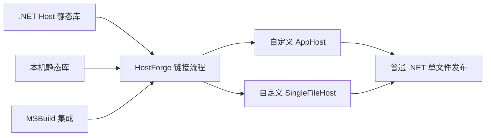

# HostForge

[](https://www.nuget.org/packages/ChsBuffer.Avalonia.AppHost/)

无需 NativeAOT，也能发布不解压本机库的 .NET 单文件应用。

HostForge 将本机静态库重新链接进 .NET `AppHost` / `SingleFileHost`，替换 SDK 默认宿主，从而避免 `IncludeNativeLibrariesForSelfExtract` 带来的运行时解包。

## 项目组件

| 组件 | 用途 | 当前支持 |
| --- | --- | --- |
| [`ChsBuffer.Avalonia.AppHost`](https://www.nuget.org/packages/ChsBuffer.Avalonia.AppHost/) | 已预链接 ANGLE / SkiaSharp / HarfBuzzSharp 的 Avalonia 宿主模板 | Avalonia 12；.NET 10（10.0.15）、.NET 11（11.0.0）；`win-x64`、`win-arm64`、`linux-x64`、`linux-arm64`、`linux-musl-x64`、`linux-musl-arm64`、`osx-x64`、`osx-arm64` |
| [ChsBuffer.AppHost.Static.win-x64](src/package-apphost-static/README.md) | 在普通 .NET 项目的构建/发布过程中重新链接宿主；尚未发布到 nuget.org，需从源码打包 | .NET 10 / .NET 11（每个运行时一个包版本）、`win-x64` |
| [ChsBuffer.SkiaSharp.Static](src/package-skiasharp-static/README.md) | NativeAOT 的 SkiaSharp / HarfBuzzSharp 静态库，包含 RID 包与元包 | 3.119.4 / 4.157.0：Windows、Linux glibc / musl、macOS 的 x64 / arm64 |
| [ChsBuffer.Avalonia.Native.Static](src/package-avalonia-native-static/README.md) | NativeAOT 的 AvaloniaNative 静态链接输入 | Avalonia 12.2.0；`osx-x64`、`osx-arm64` |
| [ChsBuffer.Angle.Static](src/package-angle-static/README.md) | 提供 ANGLE 静态链接输入 | `win-x64`、`win-arm64` |
| [静态图形元包](src/package-static-graphics/README.md) | SkiaSharp、ANGLE、Avalonia.Native 统一的 NativeAOT 引用入口 | SkiaSharp 覆盖 8 个 64 位 RID；ANGLE 覆盖 Windows；Avalonia.Native 覆盖 macOS |

项目仍处于预览阶段，包版本和构建接口可能继续调整。

宿主静态库从 .NET 官方产品的源码（[VMR](https://github.com/dotnet/dotnet) 的发布标签）构建，与官方运行时包同源，包含先合入 VMR、尚未回流到 `dotnet/runtime` 的安全修复。

## 工作原理



应用仍使用常规 .NET 构建和单文件发布流程；HostForge 只替换宿主生成方式，不要求启用 NativeAOT。

## Avalonia 快速开始

在 Avalonia 项目中引用宿主包：

```bash
dotnet add package ChsBuffer.Avalonia.AppHost
```

并在项目文件中启用单文件发布：

```xml
<PropertyGroup>
  <PublishSingleFile>true</PublishSingleFile>
</PropertyGroup>
```

然后正常发布：

```bash
dotnet publish -c Release
```

当 C# 项目的构建指定了 RID（`-r <RID>`、`RuntimeIdentifier`，或单文件发布推断出的 RID），且目标框架（`net10.0` / `net11.0`，含 `net11.0-windows` 等平台后缀）和该 RID 存在匹配模板时，包会自动替换 `AppHost` 与 `SingleFileHost`，注入本机库解析器，并把 ANGLE / SkiaSharp / HarfBuzzSharp 动态本机库及其符号文件排除在发布目录和单文件包之外（包括 `IncludeNativeLibrariesForSelfExtract=true` 时）。未指定 RID 的构建（如 `dotnet run`、可移植发布）保持 SDK 默认宿主，并保留所有 RID 的动态本机库；`PublishAot=true` 的项目发布的 NativeAOT 可执行文件没有 AppHost，其指定 RID 的非发布构建（如 `dotnet build -r <RID>`）同样不激活；`UseAppHost=false` 的构建在 `dotnet` 上运行；F#、Visual Basic 项目无法编译包注入的 C# 解析器。这些构建同样保持 SDK 默认行为并保留动态本机库。

完整行为和可选开关见 [Avalonia AppHost 包文档](src/package-avalonia-apphost/README.md)。通用静态链接见 [Static AppHost 包文档](src/package-apphost-static/README.md)（从源码打包，尚未发布）和 [StaticAppHost targets 说明](src/StaticAppHost.README.md)。

## 文档与示例

- [开发与构建指南](DEVELOPMENT.md)
- [Avalonia 打包说明](src/package-avalonia-apphost/DEVELOPMENT.md)
- [Avalonia 示例](samples/avalonia-sample/README.md)
- [简单 P/Invoke 示例](samples/simple-pinvoke)
- [设计与路线文档](docs/roadmap)

## License

[MIT](LICENSE.TXT)
